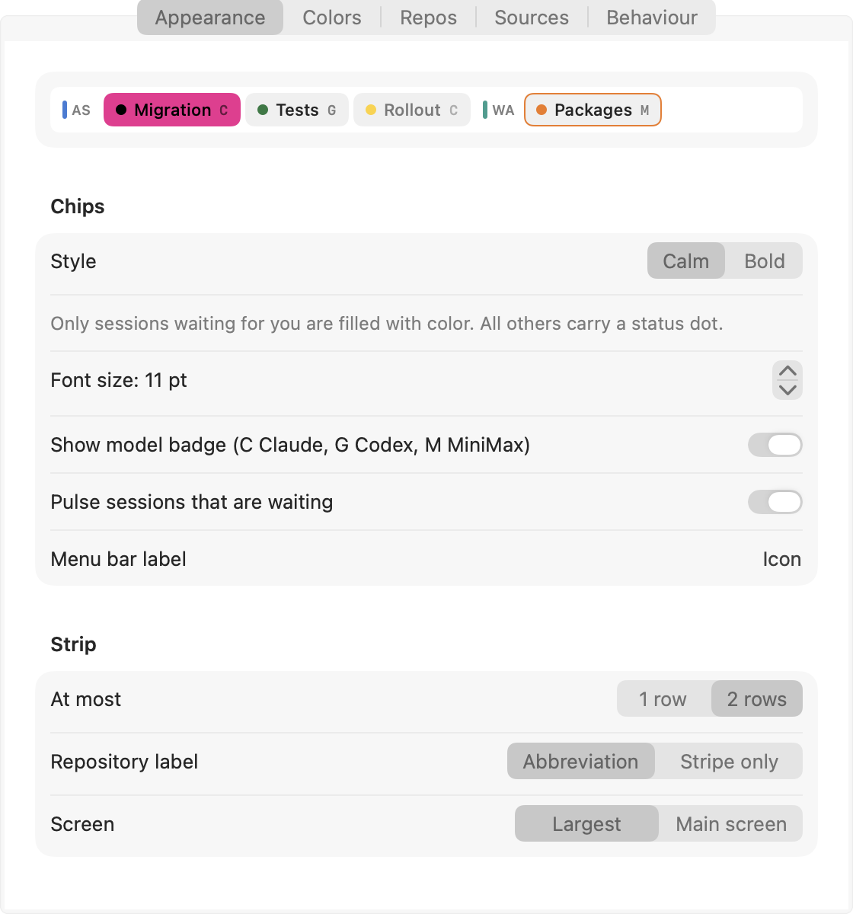
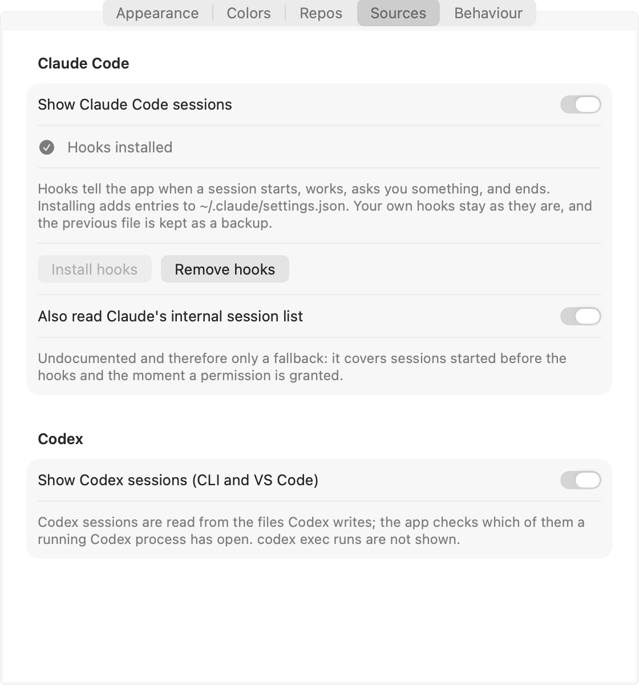

# KI-Leiste

A menu bar strip that shows every running Claude Code and Codex session at a glance, grouped by git repository.


## Features

- A strip under the menu bar, across the full width of your largest (or main) screen, plus a menu bar icon.
- Every running session is a chip with a short name and a model badge (C for Claude, G for Codex, M for MiniMax models running inside Claude Code).
- Chips are grouped by git repository; a session in a subfolder counts toward that repository.
- One or two rows depending on how many sessions are running - never a scrollbar, never a third row. Full names are available as tooltips.
- Six states: waiting for you (a question or a permission), working, ready, done, blocked, and unknown.
- Two looks: **Calm** (only sessions waiting for you are filled with color, everything else is neutral with a status dot) and **Bold** (every chip is filled in its status color).
- Click a chip to see its question, result, and model, and to copy them.
- A menu lists every session, grouped by repository.
- Windows can make room for the strip (see below), or the strip can float above them.
- macOS notifications when a session asks a question or reports that it's done; optional 3-second hints at the strip itself.

### Making room for the strip

Two placement modes, picked in Settings:

- **Push windows below the strip.** Needs the Accessibility permission. Windows move down to clear the strip and return to their place when this is switched off. A brief hide of the strip does not push windows back. The strip switches from two rows to one after an adjustable delay (5 minutes by default) so it doesn't resize on every small change.
- **Float above windows.** No special permission needed; the strip simply sits on top.

Full-screen apps hide the strip either way.

## Quickstart

### From source

Needs only the Command Line Tools, no Xcode project:

```sh
xcode-select --install   # if you don't have them yet
scripts/build.sh
```

This produces `build/KI-Leiste.app`.

## How it works

The strip collects sessions from local files and process checks only - no polling loop, just file-system events (FSEvents) plus a 10-second timer that confirms a process is still alive.

- **Claude Code.** The main source is Claude Code's own [hooks](https://code.claude.com/docs/en/hooks) (`SessionStart`, `UserPromptSubmit`, `PreToolUse` for `AskUserQuestion`, `PostToolUse`, `Notification`, `Stop`, `SessionEnd`). "Install hooks" in Settings › Sources adds them to `~/.claude/settings.json`; see [docs/hooks.md](docs/hooks.md) for exactly what that changes. Hooks apply to every Claude Code session that reads this settings file, including ones already running, because Claude Code reloads hook changes live.
- **Claude fallback (optional).** Claude Code's own internal session list (`~/.claude/sessions/*.json`) and the end of each transcript. This is **undocumented**, so it is only a fallback, and can be switched off: it covers sessions started before the hooks were installed, and the moment a permission is granted, which no hook reports until the tool call finishes. The session title shown is Claude's own session title (if renamed) or its AI-generated title, never the raw prompt text.
- **Codex.** The Codex CLI and the Codex VS Code extension (`codex exec` runs are not shown). State comes from the rollout files under `~/.codex/sessions` (turn started/ended, an open `request_user_input` question). The app matches a rollout file to a running Codex process by checking that process's open files, the way `lsof` would, without a child process. Codex has no hooks.

### States

| State | Meaning |
|---|---|
| waiting | A question or a permission is waiting for you. |
| working | The agent is busy - a turn or a tool is running. |
| ready | The agent is sitting at its prompt; nothing was explicitly reported as done. |
| done | Explicitly reported as finished (see "Explicit status reports" below). |
| blocked | Explicitly reported as blocked, or a documented hard stop. |
| unknown | No current evidence either way. |

## Settings

Everything is in Settings (⌘,), applied live, with a preview of the chips at the top.



- **Appearance:** chip style (Calm/Bold), font size, model badge, pulsing for waiting sessions, number of rows, repository label (abbreviation or just a color stripe), which screen.
- **Colors:** one color per status; restorable to the defaults.
- **Repos:** color, abbreviation, and visibility per repository. Without a color of its own, a repository uses whatever its `.vscode/settings.json` reports (`titleBar.activeBackground`, `activityBar.background`, `statusBar.background`, `statusBar.noFolderBackground`, or `peacock.color`), else gray.



- **Sources:** turn Claude Code and Codex on or off, install or remove the Claude Code hooks, toggle the Claude fallback.
- **Behaviour:** placement, the one/two-row delay, notifications, the "ready" delay, popup hints, "Open at login".

Settings are saved as readable JSON in `~/Library/Application Support/<bundle id>/settings.json`.

The app's own interface is translated: English by default, German automatically when your Mac's system language is German.

## Explicit status reports

Some states cannot be observed reliably - a finished task, a blocker, or a free-text question. An agent can report one explicitly by printing a line in its answer:

```
SESSION_REPORT: {"status":"done","result":"Migration applied and verified."}
SESSION_REPORT: {"status":"waiting","question":"Variant A or B?"}
```

Any upper-case prefix ending in `SESSION_REPORT` is accepted (for example `MYNAME_SESSION_REPORT`). Valid `status` values are `working`, `waiting` (needs `question`), `ready`, `done` (must not carry a `question`), and `blocked`. "Done" only happens this way - a turn simply ending is reported as "ready".

Outside a session, or from a script, use the helper instead:

```sh
"<app>/Contents/MacOS/<helper>" report --status done --result "…"
```

Inside a Claude Code session this needs no `--session`; elsewhere pass `--session claude:<id>` or `--session codex:<id>`.

## Privacy

KI-Leiste reads local files only and sends nothing. It contains no network code.

What is stored locally: your settings, a small state record per Claude session (status, any open question, the end of the last answer, shortened), the session register described below, and a notification ledger that holds only IDs, states, and checksums. The prompt text itself is never stored.

## Compatibility

| Component | Supported | Note |
|---|---|---|
| macOS | 13 Ventura or later | Apple silicon and Intel |
| Claude Code | Yes, via hooks | Optional undocumented fallback for older sessions |
| Codex CLI | Yes, via rollout files | No hooks; `waiting` only for an open `request_user_input` |
| Codex VS Code extension | Yes, via rollout files | Shown as session source `vscode` |
| `codex exec` | No | Not a long-running session |
| Homebrew | Not yet | Official catalog needs a signed app; own tap planned |

## Limitations

- macOS only.
- Hooks exist for Claude Code only; Codex has none, so its state comes from reading files. Codex's own permission dialogs are not detected, and `waiting` only fires for an explicit `request_user_input` call.
- Claude Code's internal session list is undocumented and can change with any Claude Code version; if it does, only the fallback cases are affected.
- "Push windows below the strip" needs the Accessibility permission, does nothing to windows that refuse to resize, and does not apply in full screen.
- Releases are not signed or notarized yet (see Quickstart above for the workaround).
- The Accessibility permission survives a local rebuild, because the ad-hoc signature's designated requirement is tied to the bundle ID, not to the changing code hash. An update to a new release build can still make macOS ask again until releases carry a Developer ID signature.
- Homebrew's official catalog does not accept unsigned apps; a separate tap is planned.

## Command line

The helper lives inside the app bundle at `<app>/Contents/MacOS/<helper>`:

```
hooks status|install|uninstall [--settings <file>]   Claude Code hooks in settings.json
report --status <state> [--result …] [--question …]  report this session's state
collect [--no-write] [--hooks-only]                   print the sessions the app sees
claude-hook                                           (run by Claude Code, reads one event on stdin)
```

## Building and testing

Needs only the Command Line Tools (`xcode-select --install`) - no Xcode project.

```sh
scripts/build.sh              # build/KI-Leiste.app for this Mac's architecture
UNIVERSAL=1 scripts/build.sh  # Apple silicon and Intel in one bundle, used for releases

Tests/run.sh                  # logic tests: layout, display, collector, providers, hooks
Tests/run.sh --native         # the same, plus real windows; needs Accessibility for your terminal app
```

